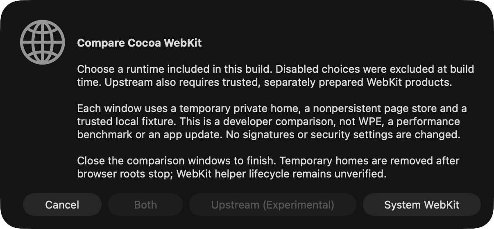

# Optional engine builds and selection

**Status, 12 November 2026:** build-time inclusion and a build-aware Cocoa comparison selector are implemented on `multiplatform`. System and upstream Cocoa WebKit are the only working configurations. Per-tab selection among different engine families is the product target, **not yet implemented**. No alternate engine SDK is downloaded by these features.

## Build inclusion is not runtime availability

There are four separate gates:

1. **Requested at build time:** Cargo features choose adapters. Defaults can be disabled.
2. **Implemented:** a native adapter actually exists. Requests for unimplemented adapters fail the build, including combinations that also request system WebKit; there is no silent fallback.
3. **Runtime available:** compatible libraries/helpers/resources and startup policy pass validation. A compiled upstream WebKit adapter does not mean its external products are installed or distributable.
4. **Selected:** the runtime actually used by a page/process. The current Cocoa comparison verifies the mapped `WKWebView` source and UUID, not just a requested feature or framework filename.

The default stays small and uses Apple's system engine. Normal startup now requires verified system-image provenance before loading a profile; an unidentified runtime cannot bypass upstream isolation. Because shared-cache classification currently uses an optional exported dyld query, an unavailable/unusable query causes an explicit startup refusal, including on an unvalidated older macOS version. This is a compatibility limitation, not a claim of support for every macOS release. Wry and the direct Objective-C WebKit dependency are optional, macOS-targeted dependencies activated by the Cocoa features. No CEF, Servo, Gecko, Ladybird, Ultralight or WPE dependency has been added as a placeholder.

## Current feature matrix

| Cargo feature            | Status on this Mac                                | Selection scope                                                                     |
| ------------------------ | ------------------------------------------------- | ----------------------------------------------------------------------------------- |
| `engine-webkit-system`   | Implemented; **default**                          | Normal browser launch, or isolated system comparison                                |
| `engine-webkit-upstream` | Implemented experimental Cocoa comparison adapter | Isolated launcher and trusted local products required; one runtime per host process |
| `engine-cef`             | Build rejected: adapter not implemented           | CEF/AppKit/GPUI lifecycle and sandboxed helper prototype required                   |
| `engine-gecko`           | Build rejected: adapter not implemented           | Maintained desktop embedding path not established                                   |
| `engine-servo`           | Build rejected: adapter not implemented           | Concrete embedding APIs found; arm64 sandbox and GPUI integration unresolved        |
| `engine-ladybird`        | Build rejected: adapter not implemented           | Frontend/Hub embedding boundary and supported presentation path required            |
| `engine-ultralight`      | Build rejected: adapter not implemented           | Proprietary license/edition, single-process security and accessibility gates        |
| `engine-wpe`             | Build rejected: adapter not implemented           | Linux investigation; no validated native macOS or Windows port                      |

Rejected features are explicit requests/guardrails, **not working SDK integrations**. `--all-features` therefore intentionally fails today. So do an empty `--no-default-features` build and the internal `_cocoa-webkit` dependency feature on its own. At least one implemented adapter must be selected. Native platform validation also rejects unsupported OS targets rather than advertising portable support through a Cargo flag.

## Build only system WebKit

```sh
cargo build --locked --bins
# Equivalent explicit selection:
cargo build --locked --bins --no-default-features --features engine-webkit-system
./target/debug/felinaut
```

The upstream comparison mode is excluded. Requesting it is rejected before opening its temporary profile or browser window. The comparison picker disables its upstream and Both choices.

## Build only upstream Cocoa WebKit

```sh
cargo build --locked --bins --no-default-features --features engine-webkit-upstream
python3 scripts/compare_macos_webkit.py --engine upstream
```

This does **not** install, download, link a production bundle, or enable unrestricted upstream browsing. Follow the [Cocoa comparison setup and security limits](macos-webkit-comparison.md). The launcher supplies the loader environment, expected UUID and isolated temporary home; pages use nonpersistent stores and trusted local fixtures. An ordinary unconfigured launch is refused rather than silently starting system WebKit. The system comparison choice is excluded.

## Build both Cocoa runtime choices

```sh
cargo build --locked --bins --no-default-features --features engine-webkit-system,engine-webkit-upstream
python3 scripts/compare_macos_webkit.py
# Or bounded functional verification of both:
python3 scripts/compare_macos_webkit.py --engine both --smoke --capture
```

Keeping the default and adding `--features engine-webkit-upstream` is equivalent. The launcher first reads the binary's manifest with a sanitized loader environment, then enables only built choices. Runtime products and loaded identity are validated independently. It refuses an excluded choice, even when an older products tree happens to exist on disk.

**Both Cocoa versions cannot be loaded into the same application process.** The current selector starts separate isolated processes/windows. This does not implement two Cocoa versions in adjacent tabs. A cross-process page-presentation bridge would be separate work, not a feature flag.

Add `--release` to the Cargo commands to build optimized executables. The comparison launcher currently uses `target/debug/felinaut` and `felinaut-ctl`; it does not automatically select a release executable. Existing `cargo dist` packaging remains the system-WebKit default; there is no distribution recipe for an upstream/alternate-engine app.

## Inspect a binary's build

```sh
./target/debug/felinaut --list-engines
```

This outputs JSON (`schema_version: 1`) before profile/window initialization. Each descriptor includes `id`, `feature`, `family`, `built`, `adapter_implemented`, `requires_isolated_launcher` and a `limitation`. It reports no profile paths, account information or browsing contents. It lists researched candidates honestly as unimplemented, not as ready engines. `built` alone is **not a runtime availability or sandbox claim**.

## macOS evaluation and next implementation gates

- [CEF and Gecko source/API investigation](macos-cef-gecko.md): CEF is the next broad-compatibility candidate; first prove its application class, event pump, view ownership, sandboxed helpers and shutdown with GPUI 0.2.2. Gecko lacks an established maintained desktop SDK for this app.
- [Servo, Ladybird and Ultralight source/API investigation](macos-experimental-engines.md): concrete entry points, pins, licenses, input/presentation requirements and security blockers. These reports do not claim that an SDK was downloaded or an alternate page ran here.
- Servo is the next independent open-source embedding experiment after the CEF lifecycle spike, scoped to trusted loopback content until the inspected arm64 sandbox gap is resolved. Ladybird needs a frontend/Hub boundary investigation. Ultralight is a trusted-UI experiment only after license review, not a safe arbitrary-site backend by default.

For each implemented adapter, replace its explicit unsupported gate only with real adapter/context construction, target-specific optional dependencies, runtime checks, behavioral tests and native loopback evidence. Do not turn `adapter_implemented` on to make an empty feature build green.

Future per-tab selection uses stable backend IDs, new-tab defaults and isolated backend/profile contexts. Reopening a loaded tab recreates its page and loads the URL anew; preserve recovery, unsaved-work/POST decisions, independent downloads and generation-safe callbacks. The [backend contract](engine-backends.md) remains authoritative.

## Validation evidence for this slice

On macOS 27 arm64, default system-only, upstream-only and combined builds each passed Clippy with warnings denied, browser/CLI unit tests, and actual rebuilt-browser loopback smoke for their included runtime(s). The combined run captured both real windows. Actual Cargo checks also rejected no-engine builds and each unimplemented candidate. The native picker was displayed/captured with system-only choices; selection itself was not automated. Exact suite counts and current native harness results are recorded in [macOS backend status](macos-backend-status.md).

The pure Rust selection model tests success, exclusion, invalid IDs, duplicate/empty configurations, unsupported platforms and unimplemented candidates even alongside a working fallback. Python tests execute the real build script with explicit Rust feature configurations, exercise manifest parsing/picker gating and preserve isolation/cleanup/capture regression coverage. None of these tests establishes alternate-engine native support.


