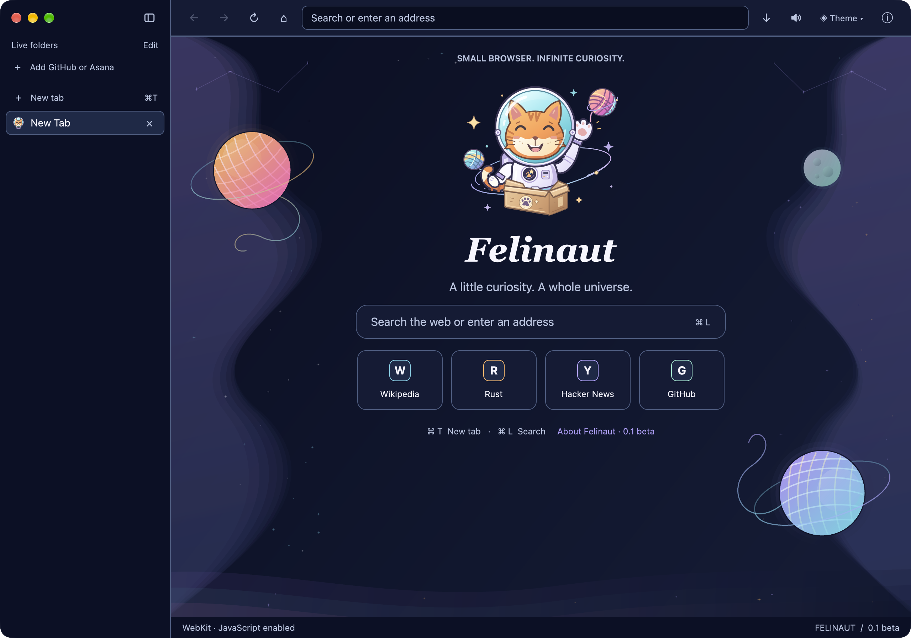
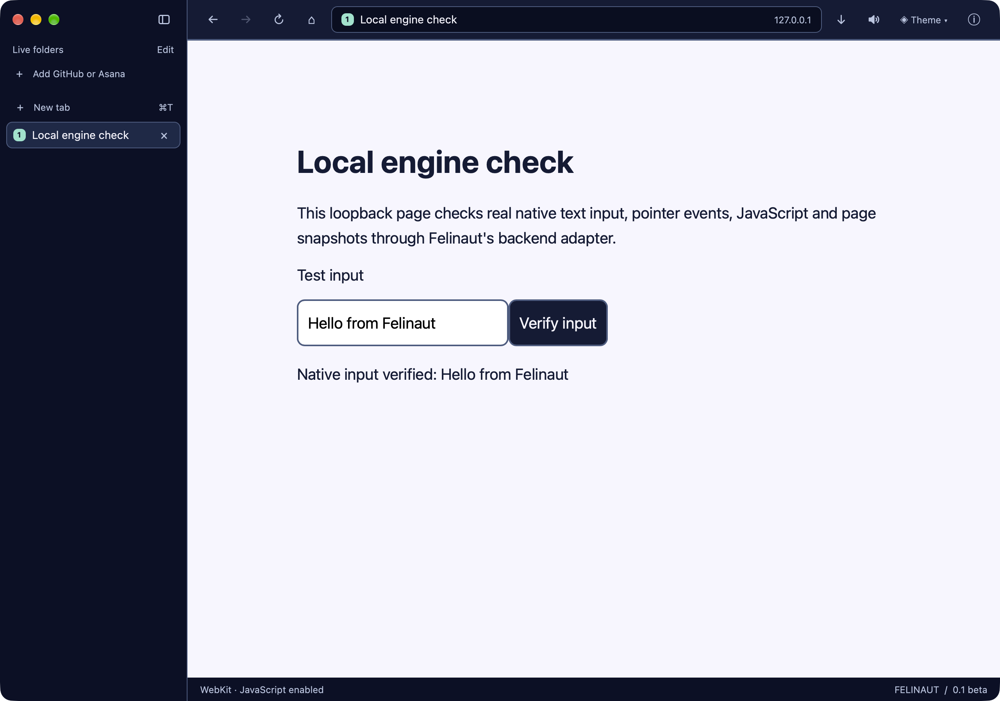

# macOS backend implementation status

**Cocoa developer comparison: functional smoke PASS. WPE comparison: not ready.** The current working implementation can launch real Felinaut against system WebKit and a trusted upstream Cocoa WebKit runtime in separate processes. It does not implement WPE, a production engine preference, or live engine switching.

## Current Cocoa comparison progress

Recorded on **12 November 2026**, on **macOS 27.0 (26A428), arm64, Xcode 27.0 (27A266a)**. Implementation checkpoints on `multiplatform` are **`c725750`** (mapped runtime identity), **`fa0fd6a`** (build gates and isolated startup), and **`acff4cd`** (build-aware launcher/picker). Initial native evidence was gathered from the working tree based on `ac9f00c`; the committed checkpoints were then revalidated in a separate checkout.

| Requested runtime | Reported WebKit version | Mapped `WKWebView` image source | Image UUID                             |
| ----------------- | ----------------------- | ------------------------------- | -------------------------------------- |
| System            | `22625.1.29.11.27`      | `system-shared-cache`           | `AC293B1A-9EAF-34D8-86B2-914D2ABB84F3` |
| Upstream Cocoa    | `627.1.8+`              | `external-framework`            | `FBC915B7-CB20-3E09-BBE5-BC236EC075B9` |

Both real-browser functional smoke runs passed runtime selection, trusted native input/click, JavaScript, page PNG and storage-isolation checks using a trusted loopback fixture. This is not a benchmark, helper-provenance check or sandbox audit. The [comparison guide](macos-webkit-comparison.md) has runnable picker, interactive and bounded smoke commands, the pinned archive and its signing/cleanup limitations. Products were manually prepared on this Mac; no full WebKit source build was attempted.

Current validation passed: browser and packaging-launcher formatter/Clippy checks (warnings denied); **149 browser unit tests, 2 ignored; 4 control-client tests; 1 packaging-launcher test; 255 Python tests**, including 61 comparison-tool tests and 4 build-gate tests executing multiple real Rust build-script configurations. Default system-only, upstream-only and combined Cocoa builds each passed Clippy, browser/CLI tests, debug and optimized release builds, and actual loopback smoke for their selected runtime(s). Actual Cargo checks rejected no-engine builds and all six unimplemented candidate requests, rather than silently falling back. No CEF, Gecko, Servo, Ladybird, Ultralight or WPE adapter was built or run.

All three opt-in native harnesses (`native_webview`, `native_audio`, `brand_ui`) actually ran and printed `PASS`, including a rerun with both Cocoa features enabled; the webview harness emitted two sandbox-extension file warnings without failing its behavioral checks. `python3 scripts/smoke_macos_backend.py --run` also passed through normal system-runtime startup, and a fresh `python3 scripts/compare_macos_webkit.py --engine both --smoke --capture` passed both isolated runtimes. The native picker was displayed/captured against the actual system-only and combined build manifests in bounded checks, then its processes were stopped; button selection was not automated. The historical counts below describe only the earlier boundary work.

[Engine build configurations](engine-builds.md) document feature combinations, the profile-free `--list-engines` manifest and disabled picker choices. Normal startup now rejects unverified runtime provenance before loading profiles; missing dyld evidence is an explicit compatibility failure, not a silent external-runtime downgrade. Mixed-engine per-tab selection remains unimplemented. The exact `acff4cd` checkout also passed all 255 Python tests and a rebuilt two-runtime smoke with window captures before publication.

Clean captures of the actual rebuilt comparison windows:


## Historical native-boundary evidence

Checked on **12 November 2026**, **macOS 27.0 (26A428), arm64**, with full Xcode/Metal available. The native seam and diagnostics are in implementation commits `9fda117` and `5546661` on `port-macos-backend-boundary`, based on `a1c9c80` from `origin/multiplatform`. The final smoke/capture run rebuilt the Rust binaries at `5546661`; only the validation tooling and documentation were then uncommitted. The embedded Git hash identifies source history, not a guarantee that the entire working tree is clean.

- [`src/page.rs`](../src/page.rs) defines the browser-facing `PageBackend`, shared page events, optional capabilities and safe diagnostic metadata. Browser tabs, live-folder pages and automation now use that boundary instead of storing a concrete `NativePage`.
- [`src/page/macos.rs`](../src/page/macos.rs) adapts the existing WKWebView implementation. Native objects and existing callbacks remain in [`src/webview.rs`](../src/webview.rs); download internals remain macOS-specific. No native view/process/storage implementation was replaced.
- Optional operations default to explicit unsupported errors, including an error callback for unsupported snapshots. Required navigation/presentation operations have no default successful no-ops.
- `felinaut-ctl backend` reports the current backend, engine family, runtime version and the first optional-capability flags. It works on New Tab without loading a website and does not report URLs, profile paths or account information.

Observed diagnostic output on this machine:

```json
{
  "backend": "native-webkit",
  "engine_family": "webkit",
  "runtime_version": "22625.1.29.11.27",
  "capabilities": {
    "zoom": true,
    "audio_control": true,
    "trusted_input": true,
    "snapshot": true,
    "certificate_exceptions": true
  }
}
```

The version is the installed WebKit framework version reported by Wry, not a Safari marketing version or a claim that every WebKit media/site feature works. The result is an observation, not a required version for another machine.

## Historical native-boundary validation

Passed for the older `5546661` native-boundary run described above (not the current comparison working tree):

```sh
cargo fmt --all --check
cargo clippy --locked --all-targets -- -D warnings
cargo test --locked --bins
cargo build --locked --bins
cargo fmt --manifest-path tools/dist/Cargo.toml --all --check
cargo clippy --locked --manifest-path tools/dist/Cargo.toml --all-targets -- -D warnings
cargo test --locked --manifest-path tools/dist/Cargo.toml
python3 -m unittest discover -s scripts -p 'test_*.py'
FELINAUT_NATIVE_TEST=1 cargo test --locked --test native_webview
FELINAUT_NATIVE_TEST=1 cargo test --locked --test native_audio
FELINAUT_NATIVE_TEST=1 cargo test --locked --test brand_ui
python3 scripts/smoke_macos_backend.py --run --capture --output target/native-backend-commit-validation
```

Results: **129 browser unit tests passed, 2 ignored; 4 control-client tests passed; 1 packaging-launcher test passed; 190 Python tests passed, including 28 tests for the preserved smoke tooling.** All three opt-in native harnesses actually ran and printed their `PASS` markers; they were not default skipped runs. Native webview testing exercised adapter metadata, rejected schemes, zoom, JavaScript/DOM/storage/history, failed loads, link events and download confinement/hidden-page denial. Native audio and brand/UI tests also passed. WebKit printed two sandbox-extension file warnings in the webview harness; the behavioral checks still passed. This is not a separate audit of Apple's sandbox.

The reproducible rebuilt-browser [smoke tool](../scripts/smoke_macos_backend.py) used a temporary app-managed HOME and a local HTTP fixture, driven by `felinaut-ctl`. It also sets the child process's `CFFIXED_USER_HOME`; full production profile selection/isolation remains separate contract work:

- Verified backend diagnostics before navigation and after page load.
- Took fresh element snapshots, inserted text through native input and clicked a real page button. The fixture confirmed the expected value and `isTrusted` pointer event.
- Evaluated the result through the page adapter and saved/decoded the engine's PNG snapshot.
- Captured only the test browser's window; no personal browser session, credentials or accounts were used. Incidental PNG text/EXIF metadata was removed.

The development process was stopped after testing. The installed app and any existing personal browser process were not replaced, restarted or modified.

### Reproduce without scratch files

Build the debug binaries, then explicitly opt into the real-browser check:

```sh
cargo build --locked --bins
python3 scripts/smoke_macos_backend.py --run
# Optional: actual browser-window captures, never the whole desktop:
python3 scripts/smoke_macos_backend.py --run --capture
```

The tool creates a new private output directory under `target/` by default, stops its browser/server and removes its temporary HOME on exit. `--output NEW_DIRECTORY` can choose a destination but refuses an existing directory; the recorded validation path above must not be reused without choosing a new name. Default mode performs no desktop capture. Capture mode needs a macOS desktop session, Swift tools and Screen Recording permission.

The [fixture HTML](../scripts/fixtures/native_backend.html), [PID-scoped window helper](../scripts/backend_window.swift), and [offline unit tests](../scripts/test_smoke_macos_backend.py) are all tracked source. Generated helpers, logs, snapshots, tokens and profiles are not release/source assets and remain outside Git. No build or GUI starts when the Python module is imported.

### Actual running UI

New Tab, with decorative animation disabled for a stable capture:



Local fixture after trusted native input and click:



These are smoke-test captures, not a complete six-theme visual baseline or a performance benchmark. No latency, battery, frame-rate or whole-process memory result is claimed; these older captures are not evidence of the new Cocoa runtime comparison.

## What is not finished in the shared boundary

This is a first behavior-preserving seam, not the entire contract in [engine-backends.md](engine-backends.md). Generation-scoped callback invalidation, a complete cancellation/decision layer, independent profile selection, portable host services and backend-owned download adapters still need implementation and review. Existing macOS callback behavior is preserved rather than advertised as newly generation-safe. The GPUI semantic-accessibility baseline is still unresolved. Other platform agents should coordinate against this explicit scope, not infer those facilities from the trait's existence.

## Concrete WPE macOS blockers

Read-only environment checks found CMake, Ninja and pkg-config. The following modules were **not discoverable in the active pkg-config search path**:

```sh
pkg-config --modversion wpe-webkit-2.0 wpe-platform-2.0
```

A successful WPE configure/build was not attempted. Missing local packages alone do not prove a port is impossible. The independent upstream check found:

- WPE's [official FAQ](https://wpewebkit.org/about/faq.html) still documents Linux-based OS support and Android work, not a supported macOS embedder.
- Modern [WPEPlatform](https://wpewebkit.org/about/architecture.html) supplies Wayland, DRM/KMS and headless implementations, not a ready-made AppKit/Metal integration.
- At WebKit revision [`2fbc5b5f4b86d36fd212c3b5207d70e6f8a97ec7`](https://github.com/WebKit/WebKit/tree/2fbc5b5f4b86d36fd212c3b5207d70e6f8a97ec7), the [headless EGL path](https://github.com/WebKit/WebKit/blob/2fbc5b5f4b86d36fd212c3b5207d70e6f8a97ec7/Source/WebKit/WPEPlatform/wpe/headless/WPEDisplayHeadless.cpp) uses GBM or a Mesa surfaceless extension. Offscreen buffers do not establish a runnable macOS engine or Metal bridge.
- [WPE build options](https://github.com/WebKit/WebKit/blob/2fbc5b5f4b86d36fd212c3b5207d70e6f8a97ec7/Source/cmake/OptionsWPE.cmake) and the GLib launcher do not establish a maintained macOS confinement path. Separate engine processes must not be presented as equivalent to a validated sandbox.

No package was installed, no upstream outreach performed and no unsupported WPE dependency added. A maintained native Darwin build/graphics/sandbox recipe is the next prerequisite to establish; Linux results or a VM do not validate a native Mac comparison.

## When a WPE comparison can start

The working Cocoa runtime picker does not resolve these WPE gates. Only mark a WPE picker ready after:

1. A pinned WPE runtime and its helpers build/run natively on the comparison Mac.
2. Its page renders inside the GPUI content area with correct resize/Retina, native input/IME, focus, buffer lifetimes and shutdown.
3. Isolation, TLS/permission behavior, clean backend-specific profiles and signing/distribution requirements are established; capability gaps are explicit.
4. Startup selection actually instantiates the requested backend, reports its real version, and fails explicitly if unavailable. No silent native fallback.
5. Equivalent local workloads can be repeated against both backends with comparable configuration and an identified security posture.

Until then, the running Felinaut cannot compare native WebKit with WPE; the available system/upstream comparison uses the Cocoa port for both. There is no reliable delivery date from the evidence available yet. Preserve the useful native refactor and investigate WPE feasibility separately rather than shipping a nonfunctional selector.
