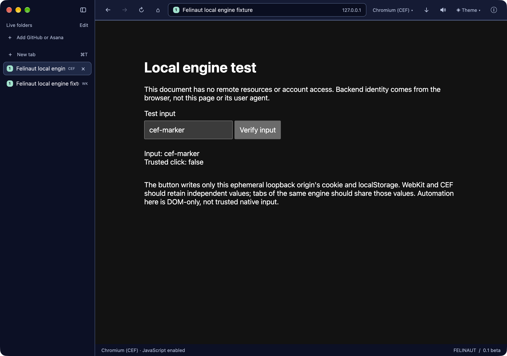

# Experimental per-tab engines on macOS

**Status, 13 November 2026:** the `multiplatform` working tree runs system WKWebView and Chromium through CEF in separate tabs of the **actual root Felinaut application**, in one GPUI window. The freshly built native arm64 mixed-engine smoke and window capture passed. This is no longer only the standalone CEF probe. **Default shipping builds remain system-WebKit-only.** This developer app is not a notarized or distributable signed package; native Intel, other macOS releases and other platforms are not validated by this run.

## How to test

Run these commands from the repository root on a native macOS arm64 desktop. Have the Rust/Xcode prerequisites from [README](../README.md#run), Python 3, CMake and Ninja available. CEF requires the exact prepared arm64 SDK and its original archive under `target/cef-runtime/156.0.26/macosarm64`; the launcher verifies them before building. Do not substitute the research-only 156.0.28 runtime.

```sh
# Inspect the plan: no build, download, file creation or launch.
python3 scripts/run_macos_engines.py

# Only if the SDK is not already prepared: explicit network acquisition.
python3 tools/cef-probe/prepare_runtime.py --download
# Offline verification of an existing prepared SDK:
python3 tools/cef-probe/prepare_runtime.py --verify

# Freshly build the root browser/helper, assemble and leave an interactive app open.
python3 scripts/run_macos_engines.py --run

# Freshly build, test only the local fixture, capture the owned window and quit.
python3 scripts/run_macos_engines.py --smoke --capture --smoke-timeout 120
```

The launcher **does not fetch the CEF SDK**. Acquisition is a separate, explicit `prepare_runtime.py --download` action; locked Rust dependencies may still be fetched by Cargo. `--run` always builds afresh, creates a private fresh `HOME`, launches and returns while leaving the interactive app open. It retains the developer bundle, logs and HOME, and prints their paths; launch success alone is not readiness validation. The assembled executable's `--list-engines` manifest is checked before launch, so a concurrent Cargo build cannot silently substitute a different engine configuration. Outputs are under a fresh `target/felinaut-engines-*` directory, with the private HOME under `/private/tmp/`. Quit the interactive app normally when finished. Do not treat retained logs/profiles as public artifacts.

`--build` assembles without launching. `--webkit-only --run` omits CEF SDK/helper access. Add `--runtime-shaders` for local development without the full Xcode Metal toolchain. `--smoke` requires both engines; `--capture` requires smoke plus a desktop session and Screen Recording permission. The smoke timeout accepts 5–120 seconds (default 90); each fresh build has a separate timeout. Use the developer bundle rather than launching a loose CEF-enabled `target/debug/felinaut`, which lacks the required framework/helper layout.

## Controls and switching semantics

- Use the **toolbar engine button** or **right-click a tab** for **WebKit** / **Chromium (CEF)**. Availability depends on the compiled adapter and initialized runtime; an unavailable engine is not a silent WebKit fallback.
- On local **New Tab**, choose the tab's engine without loading or reloading a website. This selects that tab, not a global rewrite of existing tabs.
- On a **loaded tab**, switching requires explicit native confirmation. It creates a new backend page and makes a **fresh GET** of the validated HTTP(S) URL. It does not replay a POST or migrate the document. **Forms, JavaScript/DOM state and native back/forward history are lost; cookies/logins are not copied between engines.** Unsupported settings, including CEF tab audio controls, reset to their default rather than pretending they were applied. Cancel if the page contains work you need to keep.
- The original page remains alive until the replacement reports `creation_ready`. Creation failure keeps the original page and selection; this readiness boundary is not a guarantee that the destination site will finish loading successfully. Stale replacement work must not take over a changed/closed tab.
- Mixed tabs retain independent page state and native lifetimes. Closing a CEF tab is asynchronous; it does not close another CEF page or the WebKit page. Application quit waits for all CEF browsers to close, then shuts down the CEF runtime before host exit.

For a manual check, create one tab of each engine, visit a disposable test page, type into a form, and alternate tabs. Confirm a loaded-tab switch only after accepting the loss of that document's state; cancel once to verify the original remains. Close one of two CEF tabs and verify the survivor and WebKit tab remain usable, then quit normally. Prefer local fixtures and avoid personal accounts while interactive validation is pending.

## Storage, Keychain and automation boundaries

CEF tabs share **one in-memory CEF request context**, distinct from WebKit's website-data context. The smoke verifies that two CEF tabs share their origin's cookies/localStorage while the same-origin WebKit tab retains different values. CEF cookies/logins are lost on application quit; this is not durable CEF profile support or a whole-application private-mode guarantee. No cookie migration occurs when switching. Normal WebKit browsing and the legacy `~/Library/Application Support/Felifox/` path are unchanged; the developer launcher does not open that ordinary HOME/profile.

Interactive `--run` uses the **real macOS Keychain**, not the mock test keychain. The interactive automation agent is explicitly disabled. **Real-Keychain/production secret-storage behavior has not been comprehensively validated**; a passing marked-profile smoke must not be treated as that validation. Do not infer production Keychain success from smoke success or from a fresh HOME.

Only smoke's explicitly marked, fresh private HOME permits the test-only mock-keychain policy. Smoke is restricted to its loopback fixture, not arbitrary sites or user accounts. Its type/click checks are **DOM-only**, not trusted native input (`Trusted click: false` in the capture). Manual mouse/keyboard interaction with the native CEF page is allowed, but full IME and accessibility are not validated. CEF's optional trusted-automation capability remains unsupported.

CEF evaluation uses bounded, document/context-scoped private native IPC with the shared script-request ledger. It exposes no general native handler to websites. Its indirect eval **respects CSP** and can return an explicit CSP error; there is no CSP bypass and no claim of WKWebView evaluation parity. A browser-window capture is not evidence that CEF's optional page-snapshot capability works.

## Build and capability limits

`--features engine-cef` adds the optional CEF adapter to the default system-WebKit build. It uses the existing pinned `cef` / `cef-dll-sys` **156.4.0+156.0.26** pair and internal host/protocol crates; no additional external dependency was introduced for this integration. `engine-cef` currently also activates Cocoa platform-integration dependencies. CEF-only selection (`--no-default-features --features engine-cef`) passes all-target Clippy and unit tests; native evidence here is the mixed build, not a separately launched CEF-only app. Do not infer a Cocoa-dependency-free configuration. See [engine builds](engine-builds.md).

CEF **downloads, permissions, audio control, zoom, trusted automation input and page snapshots** are currently unsupported and explicit rather than successful no-ops. Crash recovery, complete navigation/error attribution, full IME/accessibility, durable profiles, production Keychain validation and distribution/security-update readiness remain follow-up gates. Passing the local fixture is not arbitrary-site compatibility, comprehensive sandbox coverage, signing or notarization validation.

System and upstream **Cocoa WebKit still run in separate processes** through the [comparison launcher](macos-webkit-comparison.md). Do not advertise adjacent system/upstream Cocoa tabs in one host. Use a build without `engine-cef` for that comparison launcher: comparison-mode startup explicitly refuses the CEF combination. CEF + upstream Cocoa native coexistence has **not been tested**; the mixed-tab evidence here is specifically **system WKWebView + CEF**. Gecko and the other research candidates remain unavailable as working native backends.

## Recorded native evidence

The completed root-app run on **13 November 2026**, native **macOS 27 arm64 / Xcode 27**, used:

```sh
python3 scripts/run_macos_engines.py --smoke --capture --smoke-timeout 120
```

Actual backend diagnostics reported:

| Backend          | Native runtime identity                  |
| ---------------- | ---------------------------------------- |
| System WKWebView | WebKit `22625.1.29.11.27`                |
| CEF              | CEF `156.0.26`, Chromium `156.0.8078.88` |

The run passed mixed-tab identity, same-origin WebKit/CEF cookie and localStorage separation, two CEF tabs sharing one context, independent close with a surviving page, original WebKit document retention, rejected invalid/unconfirmed switches, confirmed switches creating fresh documents, and an owned-window capture. The normal quit path closed CEF browsers and shut down the runtime; the root process returned **exit 0**, without success-path helper kills. This is not an independent reconciliation of every helper's exit or a comprehensive sandbox audit; earlier standalone helper-audit evidence has its own scope in the [CEF investigation](macos-cef-gecko.md).



The screenshot is the actual root application, not the standalone probe or a mockup, and contains only the loopback fixture. This checkpoint belongs to the `multiplatform` working tree, not a published release or PR; no clean source-commit claim is made for uncommitted integration work. Earlier harness and Cocoa-comparison results remain historical evidence in [macOS backend status](macos-backend-status.md).
