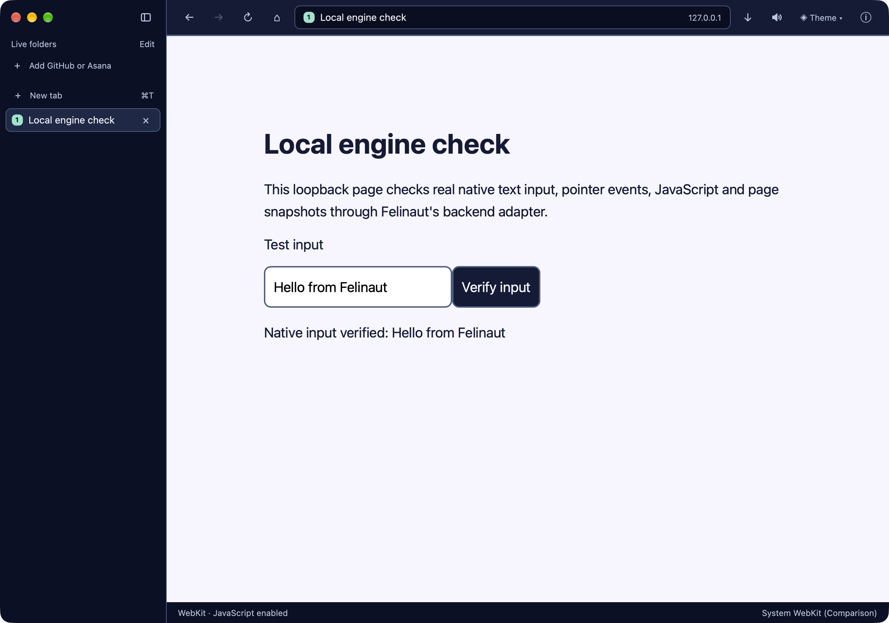
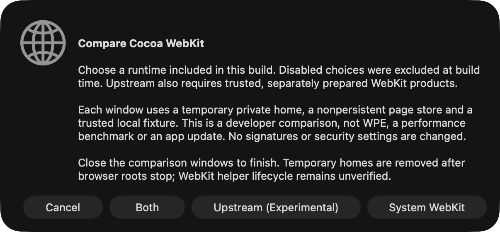

# macOS system/upstream Cocoa WebKit comparison

**Status, 12 November 2026:** real Felinaut functional smoke **PASS for both runtimes** with the uncommitted implementation based on `ac9f00c` on `multiplatform`. This is trusted-local developer tooling, not a shipped engine preference, WPE integration, performance benchmark or distributable engine bundle. Normal browser launches and the installed app remain unchanged.

## Recorded environment and runtime identity

Native run: **macOS 27.0 (26A428), arm64; Xcode 27.0 (27A266a)**.

| Selection             | WebKit version     | Mapped `WKWebView` image source | Image UUID                             |
| --------------------- | ------------------ | ------------------------------- | -------------------------------------- |
| System WebKit         | `22625.1.29.11.27` | `system-shared-cache`           | `AC293B1A-9EAF-34D8-86B2-914D2ABB84F3` |
| Upstream Cocoa WebKit | `627.1.8+`         | `external-framework`            | `FBC915B7-CB20-3E09-BBE5-BC236EC075B9` |

These are observations on this Mac, not required system WebKit versions for other machines. Both selections use the native Cocoa `WKWebView` backend (`native-webkit`, engine family `webkit`); neither is WPE. An embedded Git hash identifies source history, not a clean working tree. See [macOS backend status](macos-backend-status.md) for current full-suite results and the earlier native-boundary evidence.

## Prerequisites: manually prepared, trusted local products

Run from the repository root on a macOS desktop session, with the Rust/Xcode prerequisites in the [README](../README.md#run), Python 3.11+, and Xcode tools including `xcrun dwarfdump`. The native picker and optional window capture compile Swift helpers. Window capture also needs Screen Recording permission.

The default products directory is **already prepared on this Mac**:

```text
target/engine-comparison/upstream/Release
```

There is no downloader or automatic archive preparation. On another machine, obtaining and manually preparing trusted Cocoa WebKit products is a prerequisite. Keep the extracted framework/XPC layout, **symlinks and executable permissions** intact. The directory supplied to `--products` must contain the frameworks directly, not an extra archive wrapper:

```text
Release/
  WebKit.framework/
  WebCore.framework/
  JavaScriptCore.framework/
  WebGPU.framework/
  WebKitLegacy.framework/
```

The launcher checks framework links/resources, contained paths, host-architecture Mach-O UUIDs, and WebKit's required XPC service executables. These structural checks are not authentication or a security audit. Do not flatten symlinks, copy only `WebKit.framework`, or repair signing to make validation pass. A different products tree must be independently trusted and compatible with the native OS/architecture; `--products` does not make an arbitrary WebKit build usable.

### Pinned official archive used here

The archive is linked from upstream's [WebKit build archives](https://webkit.org/build-archives/):

| Field                      | Recorded value                                                                                                                                                   |
| -------------------------- | ---------------------------------------------------------------------------------------------------------------------------------------------------------------- |
| Archive                    | [mac-tahoe-x86_64-arm64-release/326536@main.zip](https://s3-us-west-2.amazonaws.com/minified-archives.webkit.org/mac-tahoe-x86_64-arm64-release/326536@main.zip) |
| Revision                   | `326536@main`                                                                                                                                                    |
| Commit                     | [`0d0d05bf3c5e563157c36caf89ecbc9d9c51bf78`](https://github.com/WebKit/WebKit/commit/0d0d05bf3c5e563157c36caf89ecbc9d9c51bf78)                                   |
| Reference SHA-256          | `314ddb19d3a2a320135fe8c1faa6c5e250bf4d2d345780c5cf05129e540b133d`                                                                                               |
| Compressed size            | `340568489` bytes                                                                                                                                                |
| Uncompressed size          | `1160331871` bytes                                                                                                                                               |
| Minimum macOS for this pin | **27**                                                                                                                                                           |

The reference digest records the bytes used here. **No independent publisher checksum was available; this SHA-256 is not authentication.** The launcher trusts the already-extracted local tree; it neither downloads the archive nor verifies that tree against the archive digest. Fetching the archive manually contacts upstream's archive host and transfers roughly 341 MB. Allow extraction space as well. No full WebKit source build was attempted with only about 15 GiB available; using an upstream binary archive is not a claim that Felinaut built WebKit from source.

This pin has only been natively validated here on arm64/macOS 27. Its archive name includes x86_64, but that is not native x86_64 validation or a claim of compatibility with older macOS releases.

### Signing and redistribution limits

These are development/ad-hoc-signed products, not a production bundle:

- Verification of the WebKit Mach-O code signature passes, but strict verification of the framework fails on the development symlink layout.
- JavaScriptCore signature verification reports its nested `Helpers/jsc` as modified.
- The comparison makes **no signature or security changes**: no re-signing, signature stripping, system-framework replacement or protection bypass. It does not modify product files.

Do not use this setup as a distribution recipe or ship the extracted tree with Felinaut. Helper provenance/lifecycle, sandboxing, signing, licensing, architecture completeness, security updates and packaging need separate review. Ad-hoc signing is not Developer ID signing or notarization.

## Run

Build both debug binaries with both Cocoa runtime choices first; the comparison tool does not build them:

```sh
cargo build --locked --bins --features engine-webkit-upstream
```

The default build enables only `engine-webkit-system`. The picker now disables excluded choices and the launcher checks `felinaut --list-engines` before creating profiles. For system-only or upstream-only builds, use the explicit [engine build configurations](engine-builds.md). A compiled adapter does not establish product availability; runtime layout and loaded image checks remain mandatory.

If full Xcode/Metal is unavailable, the browser build can use `-F gpui/runtime_shaders`; native comparison still requires compatible Xcode command-line tools and a desktop session.

Choose a runtime with the native picker:

```sh
python3 scripts/compare_macos_webkit.py
```

Or explicitly launch both real Felinaut windows:

```sh
python3 scripts/compare_macos_webkit.py --engine both
```

Interactive mode runs the fixture checks first, then waits **until the comparison windows close**. It is intentionally not time-bounded. Ctrl-C requests cleanup of the owned browser roots. `--engine system` and `--engine upstream` select one runtime without the picker; system-only mode does not require upstream products.

For a bounded check with actual window captures:

```sh
python3 scripts/compare_macos_webkit.py --engine both --smoke --capture
```

`--smoke` without `--engine` also selects both and never opens the picker. Omit `--capture` to avoid desktop capture; the smoke still creates engine-rendered page PNGs. Smoke work shares a 65-second budget plus bounded cleanup (under 90 seconds); optional Swift helper compilation has a separate 60-second timeout. This is not a benchmark timing.

For an alternative manually prepared tree, pass `--products` with its path. This example explicitly selects the existing default tree:

```sh
python3 scripts/compare_macos_webkit.py --engine both --smoke --products target/engine-comparison/upstream/Release
```

No arbitrary URL option is provided: use only the trusted, self-contained loopback fixture.

## What PASS means

The launcher starts a loopback fixture server and separate browser processes. It then:

1. Checks backend identity before navigation and after the page loads, with no silent system fallback for an upstream request.
2. Takes fresh element snapshots, types using native input, and clicks the fixture button; the fixture confirms the text and trusted pointer event.
3. Evaluates JavaScript and saves a sanitized engine-rendered page PNG.
4. Checks an initially absent localStorage sentinel, writes a distinct sentinel per runtime at the same origin, then rechecks both stores when both runtimes run. This is a functional isolation check, not a comprehensive storage/privacy audit.
5. With `--capture`, captures each owned browser window, not the whole desktop, and strips incidental PNG text/EXIF metadata before publishing it.
6. Stops/reaps owned browser roots on exit. WebKit helper lifecycle remains unverified.

### Identity verification is deliberately narrow

Runtime diagnostics inspect the **mapped image supplying the Objective-C `WKWebView` class in the UI process**, not a user-agent string, filesystem filename or requested environment alone. They report source classification and the mapped Mach-O UUID. The upstream UUID must match the selected local WebKit binary's host-architecture UUID; system selection must be classified inside dyld's shared cache.

Shared-cache classification optionally resolves `_dyld_get_shared_cache_range`, an exported query not declared in the SDK header. If absent or unusable, classification is **unverified**, not guessed from a path. All browser startup paths now fail closed on an unverified source, missing UUID or mismatched selection. Normal startup requires verified system WebKit before loading a user profile, so an unidentified external runtime cannot bypass comparison isolation. An unavailable query can therefore refuse startup on an unvalidated older macOS version. This optional API is a compatibility risk, not a supported cross-version guarantee.

This proves **only that UI-process WebKit selection**. It does not prove which WebCore/JavaScriptCore images or WebKit helpers actually executed, establish archive authenticity, or audit sandbox/IPC behavior. Checking helper files on disk is not runtime helper provenance.

## Isolation, cleanup and artifacts

- Each owned browser process gets a fresh marked **0700** temporary directory under `/tmp`, used for both `HOME` and `CFFIXED_USER_HOME`. Comparison startup validates the private home; ordinary user profiles are not reused. Each view uses a **nonpersistent `WKWebsiteDataStore`**. This is not a general profile selector or a production private-browsing guarantee.
- Comparison top-level navigation allows HTTP(S) **literal loopback addresses** (plus `about:blank`), not arbitrary hosts or even a `localhost` hostname. **This is not a subresource firewall**: WebKit still controls subresources and web APIs. Use only the trusted fixture, not remote or hostile browsing.
- The launcher manages only browser root processes it created. It does not kill existing apps, broad process groups or unrelated WebKit processes. **WebKit helper lifecycle is unverified** even when a root exits successfully.
- Temporary homes are removed only after their owned browser roots are confirmed stopped. If stop/reap fails, the home is preserved and its location is reported. Inspect that failure rather than blindly deleting an in-use profile or claiming complete helper cleanup.
- The loopback server is stopped on exit. The installed app, normal launch defaults, existing personal browser processes and profiles are not replaced or restarted.

The tool prints a fresh private artifact directory under ignored `target/` (normally `target/webkit-comparison-*`). `--output` may choose a **new, nonexistent directory under `target/`**; existing paths are refused. Successful runs write `result.json`, per-runtime private browser logs, element snapshots and `system-page.png` / `upstream-page.png`. Capture mode adds `system-window.png` / `upstream-window.png`; compiled Swift helpers also stay in the private output tree. Failed runs may leave partial artifacts and need not produce `result.json`.

Generated binaries, products, profiles and private logs remain ignored and must not be committed. Review/sanitize actual window captures before copying selected evidence into documentation; never publish whole private output directories or account data. If a run fails, inspect its private logs, products layout/OS compatibility, runtime identity and capture permissions. Do not bypass a failed identity or signing check.

## Actual running UI evidence

These are window-only captures of the actual rebuilt Felinaut, using clean test profiles and the same local fixture. The footer distinguishes the requested, verified UI-process runtime. Captures were reviewed and incidental PNG metadata removed.




The native picker was also displayed and captured, then stopped in a bounded check; button selection was not automated:



No performance, battery, whole-process memory, broad website compatibility, IME/accessibility completeness, WPE support or release-readiness conclusion follows from this functional smoke. WPE remains a separate unresolved macOS integration project; see [web engine options](web-engines.md) and the [WPE blockers](macos-backend-status.md#concrete-wpe-macos-blockers).
