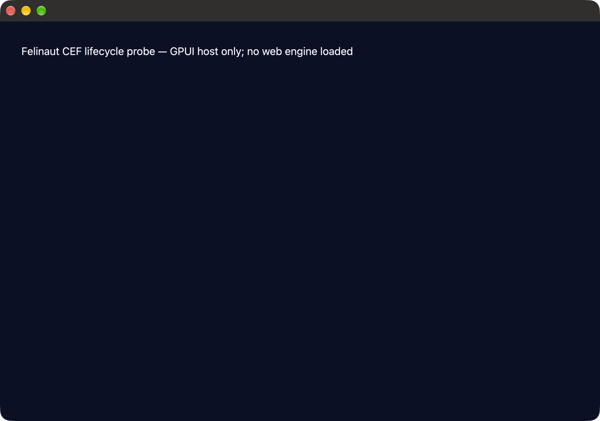
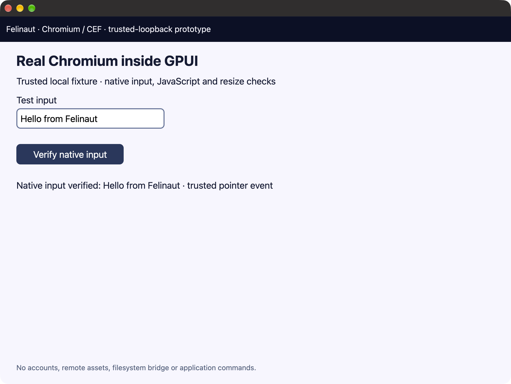

# Native CEF/GPUI lifecycle probe

Developer-only macOS arm64 investigation, separate from the browser's Cargo graph. The default build is SDK-free; the explicit `runtime` feature now loads a pinned CEF distribution and exercises a trusted loopback document inside an AppKit child view hosted by GPUI. **This is not the browser adapter or arbitrary-site support.** `engine-cef` in the browser remains explicitly unsupported. Native functional checks and the window-only visual check pass on the host below. The recorded capture contains the actual GPUI chrome and CEF document, not a mockup.

## Build and test

From the repository root, with full Xcode/Metal and a macOS desktop session:

```sh
cargo fmt --manifest-path tools/cef-probe/Cargo.toml --all --check
cargo clippy --locked --manifest-path tools/cef-probe/Cargo.toml --target-dir target --all-targets -- -D warnings
cargo test --locked --manifest-path tools/cef-probe/Cargo.toml --target-dir target
cargo build --locked --manifest-path tools/cef-probe/Cargo.toml --target-dir target

# Separate fresh processes; the first two create no window.
target/debug/felinaut-cef-probe --check-pump
target/debug/felinaut-cef-probe --check-existing-app
target/debug/felinaut-cef-probe --run-lifecycle
```

Without an explicit mode the executable returns usage/error, not a skipped native success. Lifecycle mode opens its own labelled GPUI window, checks state, and quits after roughly 1–2 seconds; a 12-second watchdog bounds the native run. Neither mode opens websites, loads a user browser profile, installs software, alters system protections or changes the installed Felinaut app. Native capture, if requested separately, must select only this process's window.

## Boundary under test

GPUI 0.2.2 registers `GPUIApplication` during its load-time constructor, but its normal explicit singleton acquisition occurs in `MacPlatform::run`. At the start of this executable, a small Objective-C++ shim:

1. Checks the actual `NSApp` global without calling `sharedApplication`.
2. Refuses an existing singleton, missing GPUI class, changed inherited `platform` ivar ABI, or duplicate probe class.
3. Registers a **new subclass** of GPUI's class. It does not modify GPUI's superclass methods, shadow the inherited ivar, mutate an existing object's class, or replace the delegate.
4. Adds scoped send-event state and a deferred termination barrier, then creates that subclass's singleton before `Application::new()`.
5. Allows GPUI to install its original delegate and initialize its inherited platform state normally.

The native checks require actual class ancestry because AppKit installs an `NSKVONotifying_…` subclass after launch on this host. Exact `isa` equality would reject the valid application. Inherited state is only observed, never written/dereferenced by the probe. Scoped dispatch restores the previous state through nested calls and an intentional Objective-C exception using `@try/@finally`; a native application-defined event also traverses superclass dispatch.

GPUI's quit request is held at the subclass's `terminate:` barrier while the host remains alive. Explicit release schedules ordinary termination asynchronously, outside GPUI borrows. The original GPUI termination callback must still run. This is a lifecycle proof, not yet CEF's asynchronous browser-close state machine.

The hook relies on a **private, version-pinned GPUI class/ivar**. Runtime checks reduce accidental ABI misuse but do not turn it into a stable GPUI API. Correct Objective-C method encodings use the SDK's `BOOL` ABI. No Rust panic crosses a native IMP; Objective-C dispatch/exception scope remains in Objective-C++.

## Recorded evidence

On **12 November 2026**, macOS **27.0 (26A428), arm64**, Xcode **27.0 (27A266a)**, baseline `f5c763c` plus this probe:

- Tool formatting and Clippy with warnings denied: passed.
- **3 behavioral unit tests**: explicit mode/argument validation, native error propagation, off-main-thread refusal.
- Fresh-process conflicting-singleton check: **PASS**, no replacement.
- Native GPUI lifecycle check: **PASS**, inherited state/delegate, nested/exception send-event restoration, termination barrier and original GPUI shutdown callback.
- Window-only capture reviewed; no personal browser data or web content was involved.



## External-pump scheduling checkpoint

`--check-pump` runs bounded native tests before creating an application singleton. The scheduler accepts CEF-style deadline notifications from any thread, serializes/coalesces them, and invokes a process-lifetime callback only from deferred main-run-loop work. The latest notification replaces the previous deadline; nonpositive delays are prompt/asynchronous and positive delays saturate at 24 hours. Common and event-tracking modes are supported without a periodic idle timer.

For the pinned CEF runtime, `pump::start_cef` explicitly opts into the reference embedder's liveness policy: positive waits cap at 33 ms, and each callback arms a 33 ms fallback only if no newer deadline is pending. Notification-only scheduling stalled actual CEF page loading on this host; this separate mode follows [CEF's pinned reference pump](https://github.com/chromiumembedded/cef/blob/8ea0c73b5dbed1389c8dafb911a98c41246bb8cb/tests/shared/browser/main_message_loop_external_pump.cc#L21-L83). Starting still waits for the first notification. While active, CEF mode wakes roughly 30 times per second even without notifications; callback work is additional, and no power/performance improvement is claimed. Stop cancels the fallback, and restarting generic mode restores no-idle-poll behavior. Extended native checks cover these transitions, capped/fallback deadlines, nested scheduling precedence and non-reentrancy.

The callback runs outside the scheduler mutex and outside GPUI rendering; nested loops cannot recursively invoke it. Stop invalidates timers, sources, callback ownership and stale queued generations before engine shutdown. A stopped callback may finish, so its owner must wait for that call to return before destroying state or unloading an engine. Old producers must be quiesced before a restart because the upstream scheduling callback carries no producer token.

The integrated native check passed on this host: coalescing/replacement, immediate/positive/extreme delays, worker wakeup, tracking mode, nested-loop non-reentrancy, stop during callback, stale work and restart. Development validation also passed 10 fresh native runs and AddressSanitizer/UndefinedBehaviorSanitizer. This proves scheduler behavior, **not actual CEF initialization or page rendering**. The future Rust trampoline must catch panics; no callback may unwind/throw through the native ABI.

## Pinned SDK preparation

Acquisition is explicit and separate from Cargo/the default browser. The matching published binding is `cef 156.4.0+156.0.26`; its runtime is CEF `156.0.26+g8ea0c73+chromium-156.0.8078.88`, macOS arm64 minimal distribution.

```sh
python3 -m unittest discover -s tools/cef-probe -p 'test_*.py'
python3 tools/cef-probe/prepare_runtime.py --download
python3 tools/cef-probe/prepare_runtime.py --verify
```

The downloader prints the absolute `CEF_PATH` for later runtime builds. No argument performs no acquisition; `--verify` is offline. Output stays under ignored `target/cef-runtime/`. The script bounds bytes/time/free space, checks publisher size/SHA-1 and records SHA-256, rejects unsafe tar paths/link traversal/special files/duplicates, preserves legitimate contained framework symlinks, and atomically publishes a private SDK directory. Existing trees require the preparation marker and full manifest/hash verification; unknown destinations are not overwritten. Exact `cef_version.h` and arm64 Mach-O headers are checked. The upstream downloader's version check permits older builds; this preparer instead pins the exact version.

Acquired/verified on this host: **134,979,837 compressed bytes**, **353,085,527 extracted file bytes**, SHA-256 **`6d7936cdd55ef30cf351a6358b2d922becefe87b25a8a8870a2b9ff5af2d39f6`**. Publisher SHA-1 **`ca4fafe7a9c52d9f28200bb8713971a9662b891c`** matched. These checks record integrity, not independent publisher authentication or an audit of binary contents. **32 offline behavioral tests passed**, including hostile archives and destination preservation.

Read-only signature inspection found linker-generated ad-hoc signatures without Team IDs. Sandbox-dylib strict verification passed; framework-bundle strict verification failed with “code has no resources but signature indicates they must be present.” No binaries/signatures/xattrs or system protections were changed. This is not a signed distribution package or permission to bypass a runtime failure. CEF has not been loaded or launched by the acquisition step.

## Isolated helper and developer bundle

The standalone workspace includes `felinaut-cef-probe-helper`, with no GPUI or Wry dependency. Its pinned CEF/sys pair uses sandbox support. It validates its child-process arguments and bundle layout, initializes the CEF sandbox before dynamically loading the framework, negotiates the API hash and executes the child role. Sandbox-bypass switches are refused; initialization requests alone do not establish effective confinement.

```sh
# Set CEF_PATH to the exact absolute path printed by prepare_runtime.py.
cargo build --locked --manifest-path tools/cef-probe/Cargo.toml --target-dir target -p felinaut-cef-probe-helper
python3 tools/cef-probe/bundle_probe.py --help
```

`bundle_probe.py` performs explicit, offline assembly only beneath ignored `target/`, refusing existing destinations and redirected inputs. It verifies the prepared SDK, thin arm64 executable headers, copied hashes, framework links, all five CEF helper layouts and bundled license/credits files. It preserves framework bytes/signatures and performs no signing, installation, security changes or launch. Preparation/bundling behavioral tests cover invalid and hostile inputs as well as success; helper tests cover role arguments and sandbox-bypass rejection.

## Owned-helper observation support

`helper_observer.py` provides a read-only observer for a future native audit run. It accepts bounded native helper-start/post-sandbox records, verifies only those PIDs using `libproc` (exact executable, parent, UID and start time), registers `kqueue` exit notifications and queries `sandbox_check` only after sandbox initialization. PID reuse, API errors, unmatched launch counts, malformed records and surviving helpers remain explicit gaps. It neither scans the process table, signals helpers nor deletes profiles. **41 offline tests pass; these tests do not establish native confinement or exit.** The current native evidence below is unchanged until this observer is integrated and run.

## Real CEF runtime probe

After explicit SDK preparation:

```sh
python3 tools/cef-probe/run_probe.py                     # plan only; no launch/build
python3 tools/cef-probe/run_probe.py --run --build       # bounded builds and native checks
python3 tools/cef-probe/run_probe.py --run --capture     # additionally require a window-only screenshot
```

`--build` prevalidates the exact prepared SDK and passes its absolute `CEF_PATH` to each bounded Cargo invocation. It builds the runtime-enabled host and the separate helper. There is no SDK acquisition in the runner. The browser's own Cargo manifest/lockfile and engine gates are unchanged.

The runner creates a new private bundle beneath `target/cef-probe-run-*`, serves only its self-contained loopback fixture with restrictive CSP, and launches with a fresh marked temporary HOME. The native executable rejects non-loopback HTTP URLs, credentials and unmarked/non-private homes. Native launch inherits only locale/text-encoding values, not shell credentials, proxy settings, loader overrides or arbitrary engine switches. Navigation and resource policies restrict the fixture origin, popups/downloads are refused, and redirect destinations are checked. This is not evidence that Chromium makes no background network requests.

### Native boundary and test sequence

- Uses the exact SDK's Objective-C `CefAppProtocol`, with protocol conformance checked at runtime. A small Objective-C translation unit avoids importing third-party C++ templates into the application bridge.
- Initializes CEF before GPUI's run loop, with `no_sandbox = 0`, the external message pump and explicit bundle/helper/cache paths. Helpers initialize the sandbox before framework loading. **Effective helper confinement remains unverified**; requesting sandbox initialization is not proof of it.
- Asynchronously creates an Alloy-style native child in a retained container, with a separate in-memory request context. CEF callbacks enqueue bounded events only; they never call GPUI directly.
- Waits for document load/JavaScript, confirms editable-field focus, types the fixture phrase through AppKit key-down/key-up pairs, and clicks its HTML button. The fixture verifies the actual value and a trusted pointer event. Keyboard injection is intentionally limited to US-layout ASCII alphabet/space—not Unicode/IME coverage.
- Resizes the GPUI/native window and requires the document to report the new 1000-pixel CSS viewport width.
- Holds application quit, dispatches browser close exactly once (including quit before asynchronous creation completes), removes only the CEF container after `DoClose`, awaits `OnBeforeClose`, cancels pumping and calls `cef::shutdown` on the main native loop before releasing GPUI termination.
- A 32-second fixture deadline, 45-second host watchdog and 60-second runner budget bound failure paths. Runner success requires all ordered markers and root exit 0. Capture failure remains a failed capture run, never a skipped success.

### Disposable Keychain policy

**This trusted-fixture-only probe enables Chromium's `use-mock-keychain` test switch.** Chromium's fake Keychain uses a public test key; it is not secure persistent secret storage and must never be copied into a real browser profile. The private test HOME has no login Keychain. A sampled earlier shutdown hung in `SecItemAdd → defaultKeychainUI → AuthorizationCopyRights`, with other Keychain tasks contending, until CEF's teardown watchdog fired. The scoped test switch prevents those authorization operations; real Keychain integration remains a production gate.

Pinned source: [test switch](https://github.com/chromium/chromium/blob/156.0.8078.88/components/os_crypt/common/os_crypt_switches.h) and [key provider](https://github.com/chromium/chromium/blob/156.0.8078.88/components/os_crypt/async/browser/keychain_key_provider.mm). No real login Keychain, signature, xattr, TLS protection or sandbox setting was modified to obtain the passing run.

### Evidence and limitations

On the same macOS 27 arm64/Xcode 27 host, actual native runs passed protocol conformance, initialization, child creation, loopback HTTP 200/JavaScript, native text and trusted pointer interaction, viewport resize, `OnBeforeClose`, CEF shutdown and original GPUI termination. Tool unit tests also cover loopback/resource policy, invalid/private profiles, mode handling and close-before-create/duplicate-close transitions. Validation passed: tool formatting, default/runtime/helper Clippy with warnings denied, **9 runtime-enabled host unit tests**, **3 helper unit tests**, **86 Python tests** (32 SDK preparation, 21 bundle, 33 runner), native pump/conflicting-singleton/lifecycle checks, and the runner's actual `--run --build` sequence with root exit 0. The default host also passed its 3 SDK-free unit tests. These checks do not replace the missing native security/visual checks below.

Private logs, reports and bundles stay under ignored `target/`; temporary homes are **retained even after success** until helper exit is independently verified. `helper_lifecycle: unverified` is explicit in the report. The runner stops only roots it owns; it does not issue global/process-group kills. Do not manually delete a retained profile until its run-owned helpers are confirmed stopped.

**Window-only visual verification passed on 13 November 2026**, after the Mac was unlocked. Two complete capture runs returned root exit 0 with every ordered native marker; the second used the normal `python3 tools/cef-probe/run_probe.py --run --capture` command without diagnostic interception. The reviewed image shows the actual GPUI header, correctly presented Chromium document, entered fixture text and trusted-click confirmation after viewport resize. It contains no personal browsing data. This verifies this static fixture's presentation, not general website compatibility, animations, IME or accessibility.



Earlier locked-session attempts failed through `screencapture` and ScreenCaptureKit despite permission preflight succeeding; the first unlocked attempt also failed window selection. Subsequent captures succeeded without changing engine or capture code. No display-wide fallback or personal-window capture was attempted. The image in the earlier lifecycle section remains SDK-free evidence only.

Not yet proved: effective renderer/GPU/utility confinement and helper exit, real persistent Keychain integration, Unicode/IME, accessibility, media, renderer-crash recovery, arbitrary-site behavior, WKWebView coexistence, per-tab selection, engine switching, signing/distribution or compatibility beyond this host. Resource/redirect negative cases currently have policy unit coverage, not an end-to-end hostile-response test. Do not enable the browser's CEF flag based on this prototype. Next: verify confinement/helper lifecycle and WebKit coexistence, then implement the production adapter against the [backend contract](../../docs/engine-backends.md). See [the CEF feasibility report](../../docs/macos-cef-gecko.md).
